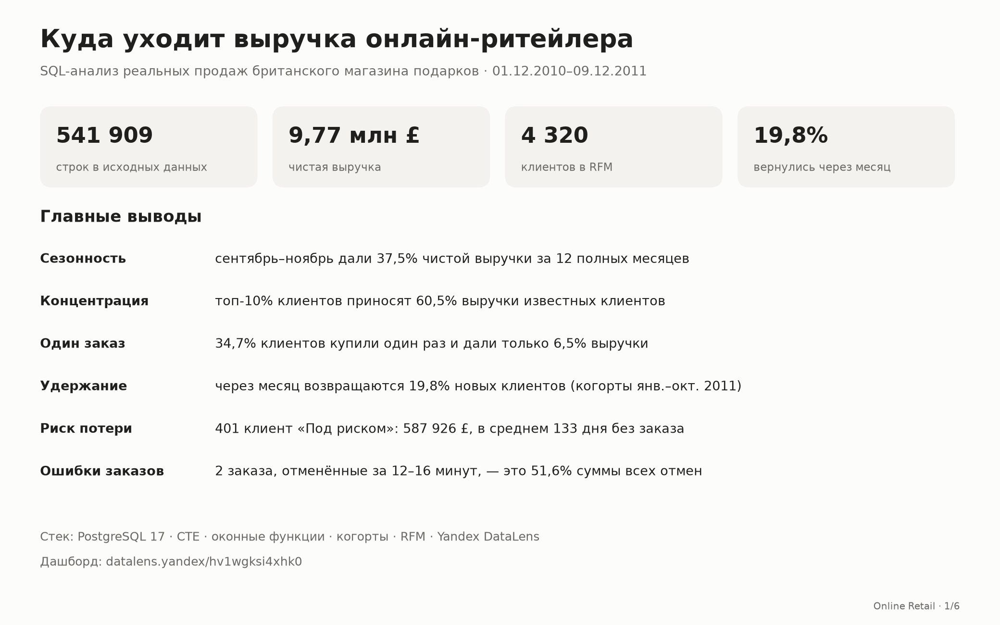
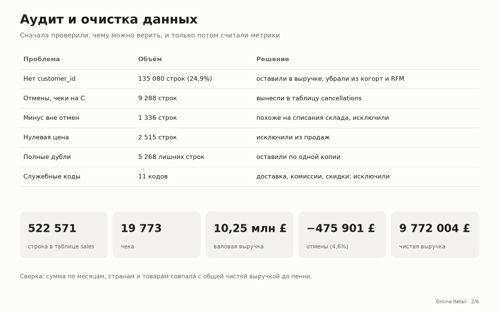
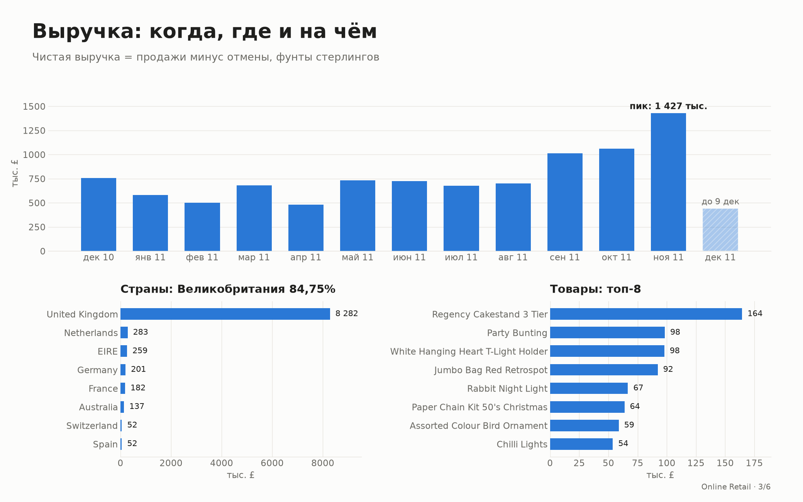
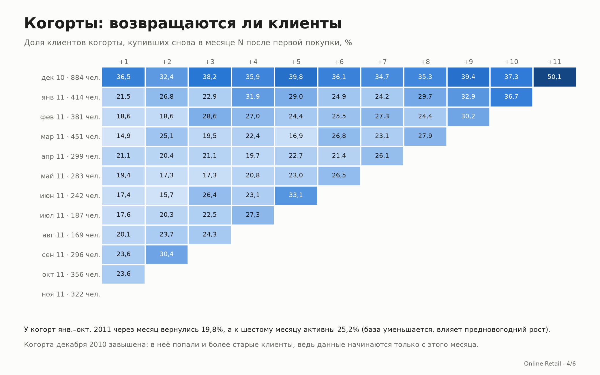
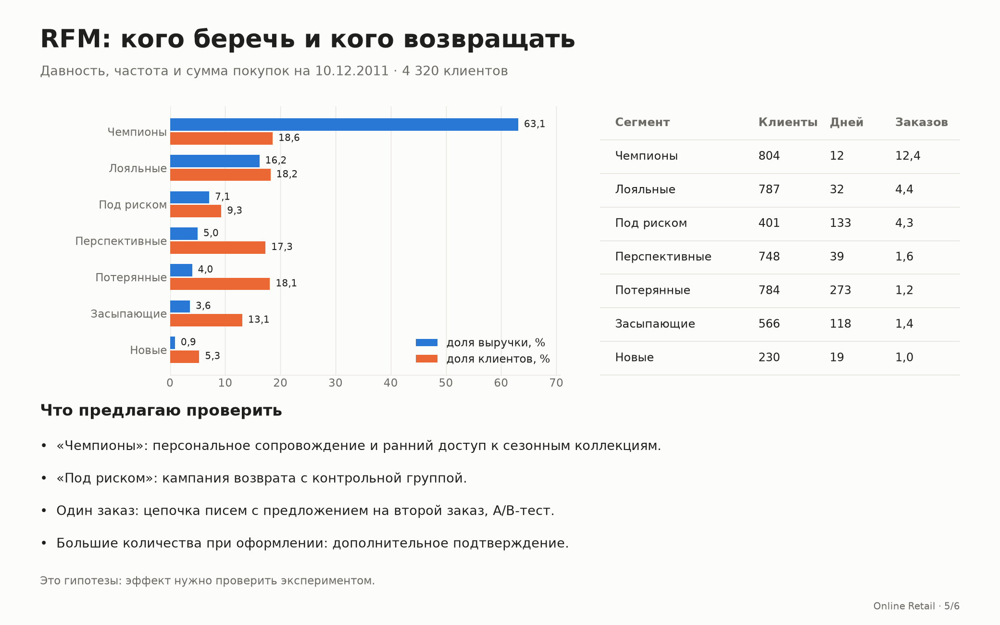
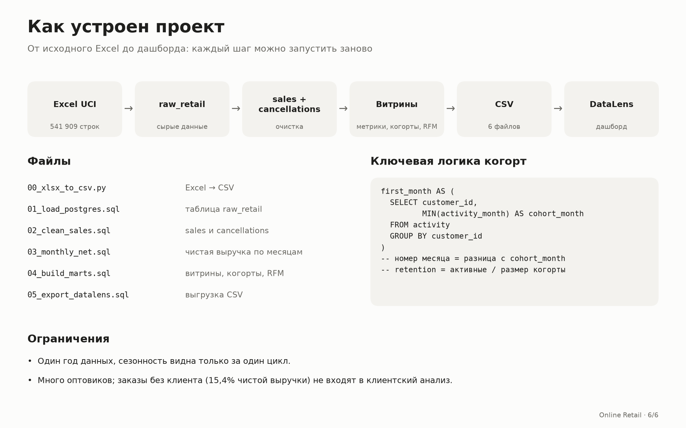

# Куда уходит выручка онлайн-ритейлера: когорты и RFM на SQL

**Stack:** PostgreSQL 17 · CTE · оконные функции · когортный анализ · RFM · DataLens
**Дашборд:** [открыть в DataLens](https://datalens.yandex/hv1wgksi4xhk0)
**Данные:** [UCI Online Retail](https://archive.ics.uci.edu/dataset/352/online+retail) — реальные транзакции британского онлайн-магазина подарков, 541 909 строк, 01.12.2010–09.12.2011.

> **EN summary.** SQL analysis of 541,909 real e-commerce transactions. I audited and cleaned the data, separated gross sales from cancellations, and built monthly, country, product, cohort and RFM marts. Key findings: net revenue is £9.77M; the top 10% of customers generate 60.5% of customer revenue; 34.7% of customers ordered only once; about 20% of a new cohort buys again in the following month; two apparent order-entry errors account for 51.6% of all cancelled value.



## Вопросы
1. Можно ли доверять данным и что нужно очистить?
2. Как меняется чистая выручка по месяцам и где её основные источники?
3. Возвращаются ли клиенты после первой покупки?
4. Какие группы клиентов приносят деньги, а какие стоит возвращать?

## Главные выводы
| Вывод | Цифра | Что сделать |
|---|---|---|
| Выручка сильно зависит от сезона | сентябрь–ноябрь дали 37,5% чистой выручки за 12 полных месяцев | заранее планировать запасы и маркетинг под IV квартал |
| Выручка сконцентрирована в постоянных клиентах | топ-10% клиентов дают 60,5% выручки известных клиентов | выделить для них персональное сопровождение |
| Многие не делают второй заказ | 34,7% клиентов купили один раз и дали 6,5% выручки | протестировать предложение на второй заказ |
| Новые клиенты возвращаются редко | у когорт янв.–окт. 2011 в следующем месяце вернулись 19,8% | сделать цепочку писем после первой покупки и проверить её A/B-тестом |
| Есть ценная группа на грани ухода | 401 клиент «Под риском», 587 926 фунтов за период, в среднем 133 дня без заказа | запустить кампанию возврата с контрольной группой |
| Часть отмен выглядит как ошибки ввода | 2 заказа на 245 653 фунта отменены через 12–16 минут: 51,6% суммы отмен | добавить подтверждение для необычно больших количеств |

## Очистка


| Проблема | Объём | Решение |
|---|---|---|
| Нет `customer_id` | 135 080 строк (24,9%) | оставлены в выручке, исключены из когорт и RFM |
| Отмены, чеки на `C` | 9 288 строк | вынесены в отдельную таблицу `cancellations` |
| Минус вне отмен | 1 336 строк, цена 0, нет клиента | похожи на списания склада, исключены |
| Нулевая цена | 2 515 строк | исключены из продаж |
| Полные дубли | 5 268 лишних строк | оставлено по одной копии |
| Служебные коды | `POST`, `DOT`, `M`, `m`, `C2`, `D`, `S`, `B`, `BANK CHARGES`, `AMAZONFEE`, `CRUK` | исключены |

**Итог:** `sales` — 522 571 строка, 19 773 чека, 4 334 клиента. Валовая выручка 10 247 905,13, отмены −475 901,16, **чистая выручка 9 772 003,97 фунта**.

## Выручка



## Когорты



## RFM


Дата расчёта — 10.12.2011. В анализ вошли 4 320 клиентов с положительной чистой выручкой.

| Сегмент | Клиентов | Доля клиентов | Выручка | Доля выручки | Дней с заказа | Заказов |
|---|---:|---:|---:|---:|---:|---:|
| Чемпионы | 804 | 18,6% | 5 219 330 | 63,1% | 12 | 12,4 |
| Лояльные | 787 | 18,2% | 1 343 688 | 16,2% | 32 | 4,4 |
| Под риском | 401 | 9,3% | 587 926 | 7,1% | 133 | 4,3 |
| Перспективные | 748 | 17,3% | 412 631 | 5,0% | 39 | 1,6 |
| Потерянные | 784 | 18,1% | 332 418 | 4,0% | 273 | 1,2 |
| Засыпающие | 566 | 13,1% | 300 818 | 3,6% | 118 | 1,4 |
| Новые | 230 | 5,3% | 72 826 | 0,9% | 19 | 1,0 |

## Ограничения
- Данные покрывают один год, поэтому сезонность видна только по одному циклу.
- Среди покупателей много оптовиков, и средний чек нельзя переносить на розничные магазины.
- Заказы без `customer_id` дают 15,4% чистой выручки и не входят в клиентский анализ.
- Когорта декабря 2010 содержит и более старых клиентов: данные начинаются только с этого месяца. Поэтому средний retention считается по когортам с января 2011.
- Retention показывает долю клиентов, активных в конкретном месяце, и на него влияет предновогодний рост.
- Декабрь 2011 неполный и исключён из когорт. В таблице месяцев он отмечен отдельно.
- Отмены не связаны с исходным чеком напрямую. Полностью отменённые чеки определены по совпадению клиента, товара, количества и цены.
- Рекомендации — гипотезы: их эффект нужно проверять экспериментами.

## Как воспроизвести


```bash
createdb retail
python 00_xlsx_to_csv.py "Online Retail.xlsx" raw/raw_retail.csv
psql -d retail -f 01_load_postgres.sql
psql -d retail -f 02_clean_sales.sql
psql -d retail -f 04_build_marts.sql
psql -d retail -f 05_export_datalens.sql
```

`03_monthly_net.sql` — отдельный запрос чистой выручки по месяцам. Готовые витрины лежат в `datalens/`.

**Источник данных:** Chen, D. (2015). *Online Retail*. UCI Machine Learning Repository. https://doi.org/10.24432/C5BW33
